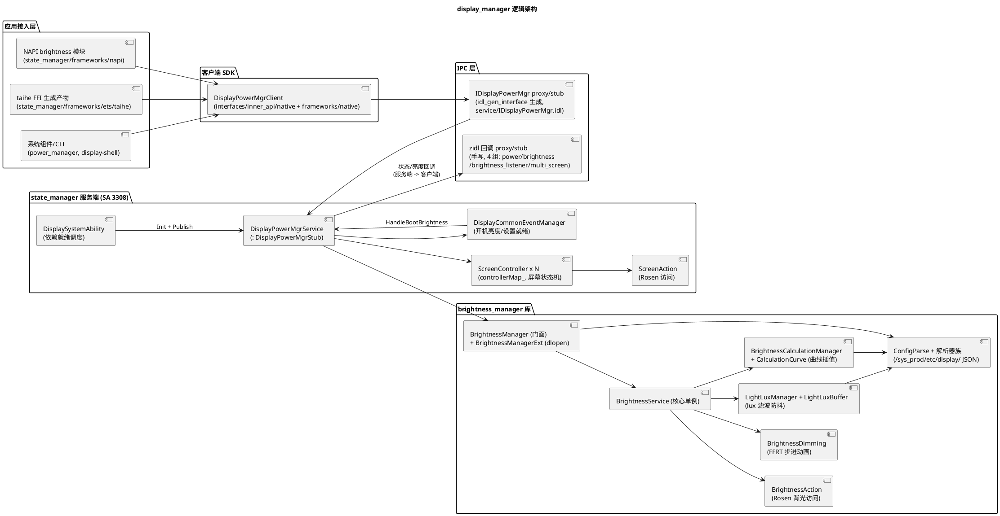

# 架构设计及约束

## 架构设计

### 设计原则

| 原则 | 描述 | 理由 |
|---|---|---|
| 双子模块单向依赖 | `state_manager`（SA 入口 + 屏幕状态机）链接调用 `brightness_manager`（亮度库，无 SA）；反向无依赖 | `bundle.json` 部件内模块划分；`displaymgrservice` 以 `dep` 引 brightness_manager，反向调用会造成循环依赖（AGENTS.md 约束） |
| 状态单一持有（服务端） | 屏幕状态只由 `ScreenController` 持有（每 displayId 一个实例，`controllerMap_`），客户端 `DisplayPowerMgrClient` 只做 IPC 转发 | `display_power_mgr_service.cpp:108-112`、`display_power_mgr_client.h:37`；客户端持有状态会与真源不一致 |
| 依赖就绪驱动启动 | SA 3308 上线后不立即初始化业务，而是监听 Rosen DMS（SA 4607）、CommonEvent、分布式 KV 三个 SA 上线事件再 Init/Publish | `display_system_ability.cpp:28-78`；屏幕动作依赖 Rosen、开机亮度依赖 settingsdata，未就绪即初始化会失败 |
| 统一经 Rosen 访问显示 | 所有屏幕状态/背光操作封装在 `ScreenAction`/`BrightnessAction`，经 `DisplayManagerLite`/`ScreenManagerLite` 转发，并用 `IPCSkeleton::ResetCallingIdentity` 重置调用身份 | `screen_action.cpp:36-54,150`、`brightness_service.cpp:585-595`；本仓无任何直接 HDI 调用（grep 无 IDisplayComposer/hdf），身份不重置会被 Rosen 权限校验拒绝 |
| FFRT 异步化 | 延迟灭屏、自动亮度设置写入、dimming 步进、锁屏超时等均在命名 FFRT 队列上执行 | `display_power_mgr_service.cpp:89`（"display_power_mgr_service"）、`brightness_service.cpp:103`（"brightness_manager"）、`brightness_dimming.cpp:46`（"brightness_animator_queue"）；powermgr 共进程，同步阻塞会拖垮电源/电池服务 |
| 门控式亮度优先级 | Override/Boost/Discount/SetBrightness 通过 `Can*` 门控互斥（屏幕亮 + 非覆盖 + 非增强才可设） | `brightness_service.cpp:951-974`；多来源并发调亮度会产生震荡 |
| 配置驱动 | lux 滤波/防抖阈值、计算曲线、折叠映射全部来自 JSON 配置（`/sys_prod/etc/display/`），代码内置值仅为默认回退 | `config_parser_base.cpp:31-39`、`calculation_config_parser.h:33-42`；产品差异由配置承载 |
| 扩展点动态加载 | 产品差异亮度逻辑经 `BrightnessManagerExt` dlopen 扩展库（特性开关 `display_manager_feature_brightnessext` 指定路径） | `brightness_manager_ext.h:74-117`；默认实现无法覆盖所有产品形态 |
| 权限在服务端入口 | 写类 IPC 入口统一 `Permission::IsSystem()`（来自 power_manager），失败置 `lastError_` 或返回错误码 | `display_power_mgr_service.cpp:358-369,538-548` 等；客户端校验可被绕过 |

### 逻辑架构

分层说明：

| 层 | 职责 | 核心类与位置 | 上下游 |
|---|---|---|---|
| 应用接入层 | ArkTS/FFI/系统组件入口 | `brightness_module.cpp`（导出 getValue/setValue/getMode/setMode/setKeepScreenOn，:194-198；RunningLock 保亮屏） | 下接客户端 SDK |
| 客户端 SDK | 进程内单例转发 + 死亡通知 + `lastError_` 错误暂存 | `DisplayPowerMgrClient`（`display_power_mgr_client.h:37-168`，`frameworks/native/display_power_mgr_client.cpp:53-70` 连接 samgr） | 上接接入层，下接 IPC |
| IPC 层 | 41 方法主接口（IDL 生成）+ 4 组回调（zidl 手写） | `service/IDisplayPowerMgr.idl`、`service/BUILD.gn:125-200`（displaymgr_interface/proxy/stub）、`service/zidl/` | 客户端 ↔ 服务端 |
| state_manager 服务端 | SA 生命周期、状态机、灭屏策略、多屏 | `DisplaySystemAbility`（`display_system_ability.cpp:26-88`）、`DisplayPowerMgrService`（`display_power_mgr_service.cpp:87-120` Init）、`ScreenController`（`screen_controller.cpp:102-158` UpdateState）、`ScreenAction`（`screen_action.cpp`） | 上接 IPC，下接 brightness_manager 与 Rosen |
| brightness_manager 库 | 亮度全链路（门面→核心→动作/动画/滤波/计算/配置） | `BrightnessManager`（`brightness_manager.h:26-101`）、`BrightnessService`（`brightness_service.h:52-248`） | 上接 state_manager，下接 Rosen/sensor/settings |

### 非功能设计

| 场景类别 | 方案设计 |
|---|---|
| 可靠性（IPC 断连） | 客户端挂 `DisplayDeathRecipient`，`OnRemoteDied` → `ResetProxy` 重连（`display_power_mgr_client.cpp:66,91`）；服务端回调挂 `cbDeathRecipient_`，客户端死亡自动清理 `callback_`（`display_power_mgr_service.cpp:531-535`） |
| 可靠性（依赖未就绪） | 服务 Init 重试获取 displayId（3 次 × 50ms，回退 0，`display_power_mgr_service.cpp:92-104`）；启动依赖 SA 监听（4607/CES/KV）；开机亮度等待 settingsdata 就绪（`display_common_event_mgr.cpp:45-56`） |
| 可靠性（状态回退） | 灭屏失败自动 Undo：`SetDisplayStateInner` 失败时 `UndoSetDisplayStateInner` 恢复原状态（`display_power_mgr_service.cpp:265-324`） |
| 可靠性（卡顿看护） | IPC 入口 `NoCoroutineSwitchGuard` + `DisplayXCollie` 看护（`display_power_mgr_service.cpp` IPC 入口包装）；DMS 锁屏等待超时上报 DMS_WAIT_LOCKSCREEN_TIMEOUT（`screen_action.cpp:117-137`） |
| 并发 | 状态用 `std::atomic<DisplayState> state_` + `mutexState_`（`screen_controller.h:99-100`）；亮度标志 atomic（`brightness_service.h:226-242`）；FFRT 队列隔离动画/延迟任务；`AutoAdjustBrightnessInner` 用 `autoBrightnessMutex_` 保证开关与设置写入原子（`display_power_mgr_service.cpp:493-511`） |
| 性能 | 查询类 IPC 标注 `TF_IMAGE` 高优先消息（IDL :28,37-39）；dimming 30ms 步长、步数按亮度差自适应（`brightness_dimming.cpp:80-97`）；lux 日志限流（2s/6 条，`light_lux_manager.cpp:29-30`） |
| 安全 | 写操作 `Permission::IsSystem()` 系统权限；参数范围校验（`CHECK_PARAM_WITH_RET`/`IS_OUT_RANGE`，`display_common.h:27,37`）；错误码区分 201/202/401/4700101-4700103（`display_mgr_errors.h:46-54`） |
| 兼容 | IDL 生成 proxy/stub 与源同步（构建期生成）；`*.map` 版本脚本约束符号可见性（`frameworks/ets/taihe/brightness/libdisplay_manager_brightness_taihe_native.map`）；IPC 码只追加不复用 |

## 架构约束

- **state_manager → brightness_manager 单向依赖**
  - **what**：`displaymgrservice` 目标链接 brightness_manager 库；brightness_manager 不得 include state_manager 头或调用其 IPC（`service/BUILD.gn` dep 关系）
  - **why**：反向调用形成循环依赖，破坏部件内分层与可测试性（brightness_manager 有独立单测）
- **屏幕状态唯一写路径**
  - **what**：状态变更必须经 `DisplayPowerMgrService` → `ScreenController::UpdateState` → `ScreenAction`；禁止绕过直接改 `state_`（`screen_controller.cpp:102-158` 唯一持有 `mutexState_` 写点）
  - **why**：绕过会跳过同态幂等、reason 语义（PRE_BRIGHT 族跳过流程）、回调通知与 HiSysEvent，订阅方状态失真
- **显示/背光操作必须经 Action 层并重置调用身份**
  - **what**：Rosen 调用集中在 `ScreenAction`/`BrightnessAction`，前后 `IPCSkeleton::ResetCallingIdentity/SetCallingIdentity`（`screen_action.cpp:38-40`）
  - **why**：Rosen 按 calling identity 校验权限；服务端转发的调用方身份可能是普通应用，不重置会被拒绝
- **亮度变更必须走 `UpdateBrightness` 统一出口**
  - **what**：映射（255→223）→ 折扣 → 直设/动画 → 设置同步集中在该出口（`brightness_service.cpp:976`）
  - **why**：绕过会绕开映射与折扣，出现"设置 255 实际 223"不一致及耗电统计失真
- **boost 与 override 互斥**
  - **what**：`CanOverrideBrightness = IsScreenOn && !IsBrightnessBoosted`，`CanBoostBrightness = IsScreenOn && !IsBrightnessOverridden`（`brightness_service.cpp:966-974`）
  - **why**：两者同时生效时恢复顺序未定义，会产生亮度跳变
- **FFRT 队列持有与生命周期**
  - **what**：队列在 Init 创建、DeInit/Reset 释放；延迟任务句柄全局保存并用 `FFRT_CANCEL` 取消（`brightness_dimming.cpp:63-118`、`display_power_mgr_service.cpp:130-147`）
  - **why**：队列先于任务析构会崩溃；未取消的延迟任务（cancel boost、延迟灭屏）在服务重置后触发野指针
- **配置与代码分离**
  - **what**：lux 滤波/防抖/曲线来自 `/sys_prod/etc/display/brightness_config/brightness_config.json`（按 display 模式分目录，支持 panelName/panelVersion 后缀回退，`config_parser_base.cpp:31-39,84-127`）
  - **why**：硬编码曲线无法适配产品差异，schema 变更影响所有产品默认亮度行为
- **powermgr 多 SA 共进程**
  - **what**：SA 3301/3302/3303/3308 同进程；亮度路径禁止阻塞 IO/长同步操作（AGENTS.md 陷阱）
  - **why**：阻塞会拖垮电源/电池/热管理同进程服务
