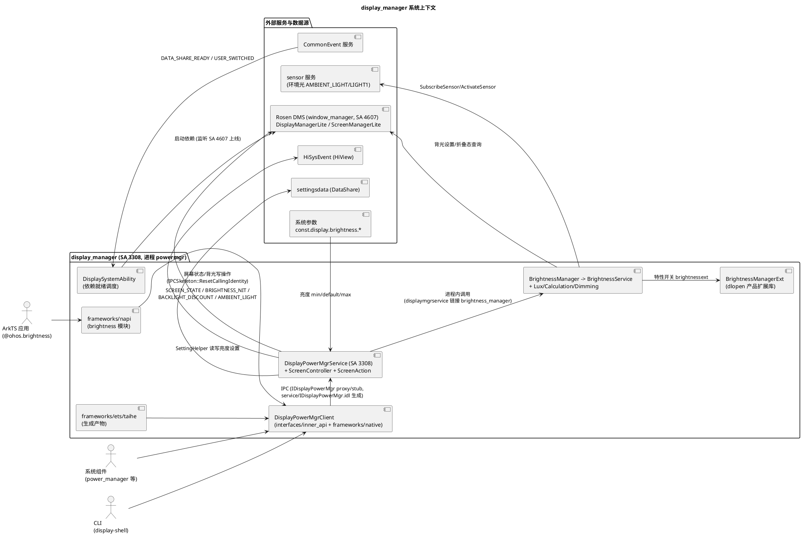

# 业务背景

## 应用定位

### 核心职责
display_manager（部件名 `@ohos/display_manager`，powermgr 子系统，系统能力 `SystemCapability.PowerManager.DisplayPowerManager`（另有 `.Lite`），`bundle.json`）实现 OpenHarmony 显示能效管理服务（Display Power Manager，简称 DPMS），SA ID 3308（`DISPLAY_MANAGER_SERVICE_ID`），进程 `powermgr`，库 `libdisplaymgrservice.z.so`，`run-on-create: true`（见 `state_manager/sa_profile/3308.json`）。仓库由两个子模块组成：`state_manager`（承载 SA 3308 与屏幕状态机）和 `brightness_manager`（亮度能力库，无 SA，被 state_manager 链接调用）。核心职责：

- **屏幕状态管理**：按 displayId 维护屏幕状态机（ON/DIM/OFF/SUSPEND/DELAY_OFF/DOZE/DOZE_SUSPEND，`state_manager/interfaces/inner_api/native/include/display_power_info.h:26-35`），接收 power_manager 等上游的状态变更请求并驱动真实屏幕亮灭（含延迟灭屏、灭屏回退 Undo、多屏与折叠态适配）。
- **亮度调节**：手动设置、自动亮度（环境光驱动）、Override（覆盖保持）、Boost（限时增强）、Discount（折扣）、SetForcedBrightness（多值型强制亮度）、睡眠亮度、场景模式（游戏/视频/常亮/商务，`state_manager/service/DisplayPowerMgrIdlTypes.idl:50-55`）；亮度上限/默认/下限来自系统参数（`state_manager/service/etc/display.para`：min=1/default=102/max=255）。
- **亮度 dimming 动画**：亮度变化经 FFRT 步进动画（30ms 步长）平滑过渡，避免背光突跳（`state_manager/service/native/include/gradual_animator.h:44-45`、`brightness_manager/src/brightness_dimming.cpp:63-103`）。
- **环境光采集与亮度计算**：订阅 sensor 环境光事件（双光感适配折叠屏），lux 缓冲滤波、防抖、按配置曲线插值得到目标亮度（`brightness_manager/src/light_lux_manager.cpp`、`brightness_manager/src/calculation_curve.cpp`）。
- **设置与开机亮度**：读写 settingsdata 亮度键（`settings.display.screen_brightness_status` / `settings.display.auto_screen_brightness`），开机时按"设置值 + 首个 lux 等待"恢复亮度（`state_manager/service/native/src/display_common_event_mgr.cpp:131`、`brightness_manager/src/brightness_service.cpp`）。
- **DFX 观测**：屏幕状态、亮度 nit、折扣、环境光分档、锁屏等待超时等 HiSysEvent（`displaymanager.yaml`，domain DISPLAY，tag PowerStats）。

### 职责边界（本组件不负责）
- **屏幕/显示状态与背光的最终执行**：本服务不直接调用 HDI；所有屏幕状态与背光写操作经 Rosen（window_manager 的 `DisplayManagerLite`/`ScreenManagerLite`，即图形侧 DMS）转发到 render service → HDI（`state_manager/service/native/src/screen_action.cpp:150`、`brightness_manager/src/brightness_action.cpp`）。显示状态真源在图形侧。
- **电源状态机决策**：亮灭屏的业务决策（超时灭屏、电源键、亮屏原因等）由 power_manager 的电源状态机负责，本服务提供执行入口（`SetDisplayState` 注释"For PowerMgrService only"，`state_manager/interfaces/inner_api/native/include/display_power_mgr_client.h:44-47`）。
- **传感器驱动与上报**：环境光传感器由 sensor 服务管理，本服务只是订阅方（`sensor_agent.h` 的 SubscribeSensor/ActivateSensor）。
- **设置项存储**：亮度值持久化在 settingsdata（DataShare），本服务只经 SettingHelper 读写与订阅，不管理存储。
- **前台 UI**：亮度控制条等由 ArkTS 应用经 `@ohos.brightness` NAPI（`state_manager/frameworks/napi/brightness_module.cpp`）开发；`state_manager/frameworks/ets/taihe/` 为生成产物、`tools/ohos-displayManager/` 为独立 npm CLI 包，按 AGENTS.md 属其他团队/生成物维护。
- **亮度扩展库本体**：`display_manager_feature_brightnessext` 指定的产品扩展 so 由产品侧提供，本仓只负责 dlopen 加载与函数指针转发（`brightness_manager/include/brightness_manager_ext.h:74-117`）。

## 系统上下文

数据流要点（均有代码依据）：
- **亮灭屏**：上游（power_manager 电源状态机）→ `DisplayPowerMgrClient::SetDisplayState` → IPC → `DisplayPowerMgrService::SetDisplayStateInner`（`state_manager/service/native/src/display_power_mgr_service.cpp:265`）→ `ScreenController::UpdateState` → `ScreenAction::SetDisplayState` → Rosen → 屏幕真实亮灭，回调后 `OnStateChanged` 通知 `IDisplayPowerCallback` 订阅方。
- **手动亮度**：NAPI/系统组件 → `SetBrightness` → `BrightnessManager::Get().SetBrightness` → `BrightnessService::UpdateBrightness` → 映射（255→223）→ 直设或 dimming 动画 → `BrightnessAction` → Rosen。
- **自动亮度**：sensor 事件 → `AmbientLightCallback` → `LightLuxManager::SetLux`（滤波+防抖）→ `BrightnessService::ProcessLightLux`（`brightness_manager/src/brightness_service.cpp:632`）→ 曲线插值 → `UpdateCurrentBrightnessLevel`。
- **开机**：SA 3308 上线即 OnStart（run-on-create）→ 监听 Rosen DMS（SA 4607）、CommonEvent、分布式 KV 上线 → 全部就绪后 Init + Publish + `HandleBootBrightness`（`state_manager/service/native/src/display_system_ability.cpp:37-78`）。

## 核心输入

| 输入类别 | 来源 | 主要内容/参数 | 触发时机 |
|---|---|---|---|
| IPC 请求 | `IDisplayPowerMgr` stub（41 方法，`state_manager/service/IDisplayPowerMgr.idl:23-82`） | 状态管理（SetDisplayState/SetScreenDisplayState/SetScreenPowerOffStrategy/SetMultiScreenDisplayState 等）、亮度（SetBrightness/SetForcedBrightness/OverrideBrightness/BoostBrightness/DiscountBrightness/SetLightBrightnessThreshold 等）、查询（GetDisplayState/GetBrightness/GetMainDisplayId/GetFeatureSupport 等）、回调注册（RegisterCallback/RegisterDataChangeListener）、RunJsonCommand | 应用或系统组件调用（SA 常驻，run-on-create: true） |
| 环境光事件 | sensor 服务（`SubscribeSensor`，采样率 `SAMPLING_RATE = 100000000`，`brightness_manager/include/brightness_service.h:167`） | lux 浮点值，双传感器 `SENSOR_TYPE_ID_AMBIENT_LIGHT(5)` / `SENSOR_TYPE_ID_AMBIENT_LIGHT1(16)`（`brightness_config_parser.h:26`） | 自动亮度开启时传感器激活后周期上报（`brightness_service.cpp:483`） |
| 折叠态变化 | Rosen `DisplayManagerLite::RegisterFoldStatusListener` | FoldStatus（UNKNOWN/EXPAND/FOLDED/HALF_FOLD） | 折叠屏开合（`brightness_service.cpp:147`） |
| 公共事件 | `DisplayCommonEventManager`（订阅 `COMMON_EVENT_DATA_SHARE_READY`，多屏下加 `COMMON_EVENT_USER_SWITCHED`，`display_system_ability.cpp:56-71`） | settingsdata 就绪通知、用户切换 | CommonEvent 服务上线后订阅生效 |
| 设置项变化 | SettingHelper observer（power_manager setting_provider） | `settings.display.screen_brightness_status`（uint）、`settings.display.auto_screen_brightness`（bool） | 用户在设置应用改动亮度/自动亮度开关 |
| 系统参数 | `DisplayParamHelper`/`BrightnessParamHelper`（`display.para`） | `const.display.brightness.default=102`、`.max=255`、`.min=1`、sleep 系列（`GetSleepBrightness/GetSleepMinumumReductionBrightness/GetSleepDarkenTime`） | 启动加载；boot 完成回调（`display_power_mgr_service.cpp:122-128`） |
| 屏幕列表 | Rosen `GetAllDisplayIds` | displayId 列表 | 服务 Init（重试 3 次、间隔 50ms，失败回退 displayId 0，`display_power_mgr_service.cpp:57-60,92-104`） |
| Rosen 状态回调 | `ScreenAction::SetDisplayState` 的 lambda 回调 | Rosen DisplayState（ON/OFF/ON_SUSPEND/DOZE/DOZE_SUSPEND） | 真实亮灭完成（`screen_action.cpp:150-175`） |

## 核心输出

| 输出类别 | 接收方 | 业务作用 |
|---|---|---|
| 屏幕状态/电源写操作 | Rosen DMS（→ render service → HDI） | `SetDisplayState`（display 状态）、`SetScreenPowerForAll`/`SetSpecifiedScreenPower`（screen 电源，协同/普通路径，`screen_action.cpp:248-264`）；调用前后 `IPCSkeleton::ResetCallingIdentity/SetCallingIdentity` 保证系统身份 |
| 背光写操作 | Rosen DMS | `BrightnessAction::SetBrightness` 等，实际生效亮度（已映射/折扣） |
| 状态变更回调 | `IDisplayPowerCallback` 订阅方（power_manager 等） | `OnDisplayStateChanged(displayId, state, reason)`（`display_power_mgr_service.cpp:596-602`），SUSPEND/DOZE 归一化为 OFF 后通知（`screen_controller.cpp:317-319`） |
| 亮度数据变化通知 | `IDisplayBrightnessListener`（按 8 类 listenerType）/ `IDisplayBrightnessCallback`（阈值触发） | 面向 APS/UI/稳定 lux 等消费方（`DisplayPowerMgrIdlTypes.idl:18-30`） |
| 多屏状态回调 | `IMultiScreenDisplayStateCallback` 订阅方 | 特定/全部屏幕（DISPLAY_ID_ALL=UINT64_MAX）状态变化（`display_power_mgr_client.h:114-132`） |
| 设置项写入 | settingsdata | 亮度值持久化（异步经 FFRT 队列，如 `display_power_mgr_service.cpp:501-511`） |
| HiSysEvent | HiView/电池统计 | SCREEN_STATE（STATISTIC，`screen_action.cpp:178-181`）、BRIGHTNESS_NIT（`brightness_service.cpp:1175-1186`）、AMBIENT_LIGHT（分 22 档 lux，`brightness_service.cpp:653-666`）、DMS_WAIT_LOCKSCREEN_TIMEOUT（BEHAVIOR，亮屏 300ms/灭屏 2000ms 阈值，`screen_action.cpp:117-137`）、ABNORMAL_FAULT（domain POWER，`powermanager.yaml`）；BACKLIGHT_DISCOUNT 在 yaml 声明但本仓无写点 |
| IPC 查询应答 | 客户端进程 | 状态/亮度/特性支持查询结果；失败经 `lastError_`（`DisplayErrors`：201/202/401/4700101/4700102/4700103，`state_manager/utils/native/include/display_mgr_errors.h:46-54`）由 `GetError()` 读取 |
| 调试输出 | CLI/hidumper 使用者 | `RunJsonCommand` JSON 命令通道（CLI `display-shell` 经此查询，`tools/ohos-displayManager/src/cli_command.cpp`） |
