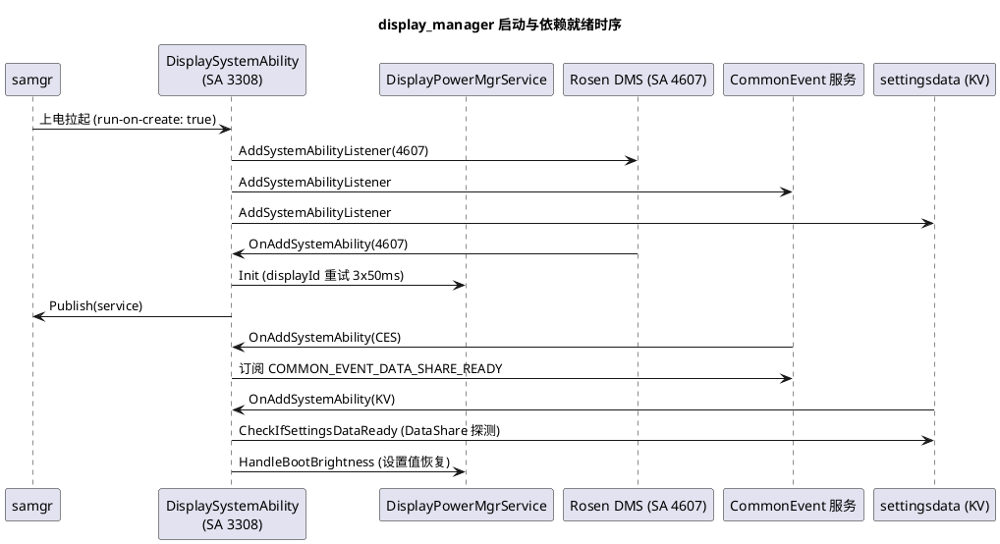

# 技术术语知识

display_manager 模块核心技术框架和机制的知识定义，涵盖价值认知、原理、使用方式和代码关联。路径均相对仓根（`base/powermgr/display_manager`）。数据与持有者见 [业务实体知识](displaymgr-Entity.md)，术语释义见 [术语表](glossary.md)，分层与约束总览见 [架构设计及约束](architecture.md)。

## IDL IPC 通道机制（主接口生成 + zidl 手写回调）

### 解决的问题（Problem）
| 子维度 | 内容 |
|---|---|
| 业务痛点 | 41 个跨进程方法（状态、亮度、查询、回调注册、JSON 命令）手写 parcel 编解码易错且难维护；反向（服务端→客户端）事件推送又需要不同粒度的回调契约 |
| 技术目标 | 正向用 IDL 声明式生成保证编解码一致性；反向保留手写以精确控制码值与死亡清理 |

### 原理（Principles）
| 子维度 | 内容 |
|---|---|
| 核心机制 | `state_manager/service/IDisplayPowerMgr.idl:23-82` 声明 41 方法（`[ipccode 0] SetDisplayState` … `[ipccode 21] SetLightBrightnessThreshold`，查询类标 `[customMsgOption flags=MessageOption::TF_IMAGE]` 高优先）；类型在 `DisplayPowerMgrIdlTypes.idl`（4 枚举）。`state_manager/service/BUILD.gn:125-200`：`idl_gen_interface("displaymgr_interface")` 生成代码，`displaymgr_proxy`/`displaymgr_stub` 两个 source_set 用 `filter_include(output_values, ["*_proxy.cpp" / "*_stub.cpp"])` 从生成物取源；`DisplayPowerMgrService : DisplayPowerMgrStub` 实现业务。回调方向 4 组（power/brightness/brightness_listener/multi_screen_display_state_callback）在 `state_manager/service/zidl/` 手写 proxy（如 `display_power_callback_proxy.cpp:33-50`：WriteInterfaceToken → SendRequest(ON_DISPLAY_STATE_CHANGED)），stub 置于 `interfaces/inner_api/native/include/` 供客户端继承 |
| 关键流程 | 调用链：客户端 `DisplayPowerMgrClient` → 生成 proxy → IPC → stub → `DisplayPowerMgrService::*Inner`（`NoCoroutineSwitchGuard` + `DisplayXCollie` 看护）→ 返回 bool/retCode 出参；事件链：服务端 `NotifyStateChangeCallback`（`display_power_mgr_service.cpp:596-602`）→ 手写 proxy → 客户端 stub → 回调实现 |

### 使用方式（Usage）
| 子维度 | 内容 |
|---|---|
| 核心 API | 新增正向方法：改 `.idl`（追加尾部）+ 服务端实现 + 客户端封装；新增事件：zidl 加 proxy/stub + `*_ipc_interface_code.h` 追加码值 + 注册入口带死亡recipient（`RegisterCallbackInner` 范式，`display_power_mgr_service.cpp:514-536`） |

### 代码关联（Code）
| 子维度 | 内容 |
|---|---|
| 核心类 | `IDisplayPowerMgr`（IDL）、`DisplayPowerMgrStub/Proxy`（生成）、`DisplayPowerCallbackProxy/Stub` 等 8 个 zidl 文件 |
| 核心成员 | 回调码枚举（如 `DisplayPowerCallbackInterfaceCode::ON_DISPLAY_STATE_CHANGED = 0`，`display_power_callback_ipc_interface_code.h:22-24`，注释 SAID: 3308） |
| 核心方法 | 服务端 41 个 `*Inner`；客户端 `GetProxy/OnRemoteDied`（`display_power_mgr_client.cpp:53-91`，失败置 `ERR_CONNECTION_FAIL`） |

### 约束与限制（Constraints）
| 子维度 | 内容 |
|---|---|
| 系统限制 | 生成代码在构建期产出（out 目录），仓库内无生成物；改 `.idl` 必须全量重编 proxy/stub |
| 并发约束 | 回调单槽 `callback_`（RegisterCallback 拒绝二次注册，:521-524）；listener 按 callerId 去重 |
| 安全约束 | 写入口 `Permission::IsSystem()`；`SetScreenPowerOffStrategy` 携带 `IRemoteObject` token（IDL `sequenceable OHOS.IRemoteObject`） |

## 服务启动与依赖就绪时序机制（run-on-create + 三依赖监听 + 开机亮度）

### 解决的问题（Problem）
| 子维度 | 内容 |
|---|---|
| 业务痛点 | SA 3308 上电即启动（`run-on-create: true`，`sa_profile/3308.json`），但屏幕操作依赖 Rosen DMS、开机亮度依赖 settingsdata，未就绪即执行必然失败 |
| 技术目标 | 常驻服务在依赖全部就绪后再初始化业务并发布，开机首屏亮度正确恢复 |

### 原理（Principles）
| 子维度 | 内容 |
|---|---|
| 核心机制 | `DisplaySystemAbility::OnStart` 注册三个 `AddSystemAbilityListener`：`DISPLAY_MANAGER_SERVICE_SA_ID(4607，Rosen DMS)`、`COMMON_EVENT_SERVICE_ID`、`DISTRIBUTED_KV_DATA_SERVICE_ABILITY_ID`（`display_system_ability.cpp:28-35`）。`OnAddSystemAbility`：4607 上线 → `DisplayPowerMgrService::Init`（displayId 重试 3×50ms 回退 0、controllerMap_、BrightnessManager Init）→ `Publish`；CES 上线 → 订阅 `COMMON_EVENT_DATA_SHARE_READY`（多屏加 USER_SWITCHED）；KV 上线或 DATA_SHARE_READY → `CheckIfSettingsDataReady`（DataShareHelper::Create 探测 `SETTING_URI_PROXY`）→ `SetKvDataReady` → `HandleBootBrightness`（:37-78、`display_common_event_mgr.cpp:45-56,77-135`） |
| 关键流程 | 开机亮度：`HandleBootBrightness`（`display_power_mgr_service.cpp:149-165`）用缓存设置亮度；亮屏时若自动亮度开，`SetScreenOnBrightness` 等首个 lux 最多 200ms（`WAIT_FOR_FIRST_LUX_MAX_TIME`）再回落设置值；boot 完成经 `DisplayParamHelper::RegisterBootCompletedCallback` 置 `isBootCompleted_`（:122-128） |

### 使用方式（Usage）
| 子维度 | 内容 |
|---|---|
| 核心 API | 无对外 API；新增启动依赖时在 `OnStart` 追加 listener 并在 `OnAddSystemAbility` 补初始化分支 |

### 代码关联（Code）
| 子维度 | 内容 |
|---|---|
| 核心类 | `DisplaySystemAbility`（`display_system_ability.cpp`）、`DisplayCommonEventManager` |
| 核心成员 | `isReady` 防重入；`kvDataReady` 状态 |
| 核心方法 | `OnStart/OnAddSystemAbility/OnStop`（:81-88 做 Deinit + 移除 listener） |

### 约束与限制（Constraints）
| 子维度 | 内容 |
|---|---|
| 系统限制 | Rosen/CES/KV 任一不上线则服务不 Init（4607 是硬前置）；displayId 获取失败回退 `DEFALUT_DISPLAY_ID=0`（拼写如此） |
| 并发约束 | 多依赖回调乱序到达，`isReady`/kvDataReady 保证幂等 |
| 安全约束 | 不适用（系统内部时序） |

## 屏幕状态机机制（ScreenController 状态演进 + reason 语义 + 延迟灭屏 + Undo）

### 解决的问题（Problem）
| 子维度 | 内容 |
|---|---|
| 业务痛点 | 亮灭屏请求来源多（电源键/超时/亮屏认证/协同/策略），存在非法转移、失败回退、通知噪声与延迟需求 |
| 技术目标 | 单一状态机收口：合法转移校验、reason 定制行为、失败自动恢复、订阅方只收到有效变化 |

### 原理（Principles）
| 子维度 | 内容 |
|---|---|
| 核心机制 | `ScreenController::UpdateState(state, reason)`（`screen_controller.cpp:102-158`）按目标态分支：ON（含 DIM→ON 直更）→ OFF/DOZE/DOZE_SUSPEND（`EnableSkipSetDisplayState(reason)` 为真——PRE_BRIGHT_AUTH_SUCCESS——则直接 `OnStateChanged`，否则 `action_->SetDisplayState(state, callback)` 异步等 Rosen 回调）→ DIM/SUSPEND 不落 Rosen。公共后置：`IsNeedSkipNextProc(reason)`（PRE_BRIGHT/AUTH_FAIL_SCREEN_OFF）短路；否则持 `mutexState_` 更新 `state_`。`OnStateChanged`（:293-323）：`action_->SetDisplayPower(state, reason)` → PRE_BRIGHT 短路 → `SkipNotify` 同态抑制 → ON 时 `SetScreenOnBrightness` 恢复灭屏前亮度 → SUSPEND/DOZE 归一 OFF → `NotifyStateChangeCallback` |
| 关键流程 | 延迟灭屏：`SetDisplayStateInner` 对 DELAY_OFF 先置 DIM 再 `FFRTUtils::SubmitDelayTask` 到期灭屏（`display_power_mgr_service.cpp:254-315`）；失败 Undo：灭屏动作失败时 `UndoSetDisplayStateInner` 恢复（:316-324）；灭屏策略：poweroff_strategy 特性下 reason 经 `MiscellaneousDisplayPowerStrategy::GetSpecificStrategyReason` 换算（`screen_action.cpp:260-263`）；多屏：`UpdateMultiScreenState` + `GetScreenLock`（`screen_controller.cpp:325-338`） |

### 使用方式（Usage）
| 子维度 | 内容 |
|---|---|
| 核心 API | `DisplayPowerMgrClient::SetDisplayState`（仅 PowerMgrService）/`SetScreenDisplayState`（任意系统组件，直接 Rosen `SetScreenPowerById`，`display_power_mgr_service.cpp:1193-1220`）/`SetScreenPowerOffStrategy` |

### 代码关联（Code）
| 子维度 | 内容 |
|---|---|
| 核心类 | `ScreenController`、`ScreenAction`、`MiscellaneousDisplayPowerStrategy` |
| 核心成员 | `state_`/`mutexState_`/`stateChangeReason_`（`screen_controller.h:99-104`）；服务侧 `screenOffDelayTaskMutex_` + 全局延迟句柄 |
| 核心方法 | `UpdateState/OnStateChanged/SkipNotify/IsNeedSkipNextProc/SetDelayOffState`；服务侧 `SetDisplayStateInner/UndoSetDisplayStateInner/ScreenOffDelay` |

### 约束与限制（Constraints）
| 子维度 | 内容 |
|---|---|
| 系统限制 | DIM/SUSPEND 请求不驱动真实屏幕（仅本地语义）；Rosen 回调异步，state_ 与真实屏幕短暂不一致属预期 |
| 并发约束 | 状态写必须持 `mutexState_`；多屏同屏操作持 `screenLock_`（ffrt::mutex） |
| 安全约束 | 入口系统权限；reason 取值来自 power_manager `StateChangeReason`，未知值按 POWER_BUTTON 兜底（`ParseSpecialReason`，`screen_action.cpp:189-218`） |

## Rosen 显示访问层机制（Action 封装 + 身份重置 + 三处枚举映射）

### 解决的问题（Problem）
| 子维度 | 内容 |
|---|---|
| 业务痛点 | 服务端转发调用时 calling identity 是上游应用，Rosen 权限校验会拒绝；本服务与图形侧存在两套 display 状态/电源/reason 枚举语义差 |
| 技术目标 | 集中封装 Rosen 调用：身份重置配对、枚举映射唯一维护点、DFX 时机统一 |

### 原理（Principles）
| 子维度 | 内容 |
|---|---|
| 核心机制 | 所有 Rosen 写操作在 `ScreenAction`/`BrightnessAction` 内 `IPCSkeleton::ResetCallingIdentity()` → 调用 → `SetCallingIdentity(identity)`（`screen_action.cpp:38-40,149-176`）。枚举映射三处：`ParseDisplayState`（DisplayState↔Rosen DisplayState，ON/OFF/DOZE/DOZE_SUSPEND）、`ParseScreenPowerState`（↔ScreenPowerState，含 DIM=STAND_BY/SUSPEND）、`ParseSpecialReason`（power reason↔Rosen reason，PRE_BRIGHT 族/POWER_KEY/APPCAST 等）。查询：`GetDisplayState` 经 `ScreenManagerLite::GetScreenPower`（:61-84），displayId 列表经 `DisplayManagerLite`（:36-54）。本仓 grep 无任何直接 HDI 调用——AGENTS.md"BrightnessAction 直接调用 HDI"的表述应理解为"经 Rosen 间接到达 HDI" |
| 关键流程 | `SetDisplayState`：Parse → 身份重置 → Rosen 异步设态（lambda 回调里 Rosen→DisplayState 逆映射 + `WriteHiSysEvent` 锁屏超时 + callback）→ 恢复身份 → SCREEN_STATE HiSysEvent（:139-187）；`SetDisplayPower`：协同屏+TIMEOUT 走 `SetSpecifiedScreenPower`，否则策略换算后 `SetScreenPowerForAll`（:248-264） |

### 使用方式（Usage）
| 子维度 | 内容 |
|---|---|
| 核心 API | 内部机制；新增 Rosen 调用必须加入 Action 层并遵循身份重置与映射规则 |

### 代码关联（Code）
| 子维度 | 内容 |
|---|---|
| 核心类 | `ScreenAction`（`screen_action.cpp`）、`BrightnessAction`（`brightness_manager/src/brightness_action.cpp`） |
| 核心成员 | `displayId_`、`coordinated_` |
| 核心方法 | `SetDisplayState/SetDisplayPower/GetDisplayState/SetBrightness`、三个 Parse 方法 |

### 约束与限制（Constraints）
| 子维度 | 内容 |
|---|---|
| 系统限制 | 依赖 SA 4607 在线（启动时序保证）；身份重置期间本服务以系统身份行为，须限定在 Action 层内 |
| 并发约束 | 无锁转发；回调与调用线程可能不同 |
| 安全约束 | 禁止在 Action 层外裸调 Rosen 写接口（会绕过身份重置被拒绝或绕过 DFX） |

## 亮度设置主链路机制（UpdateBrightness 统一出口 + 255→223 映射 + 设置同步）

### 解决的问题（Problem）
| 子维度 | 内容 |
|---|---|
| 业务痛点 | 亮度来源多（手动/自动/恢复/睡眠），若各自直设背光会绕过映射与折扣，造成设置值与实际值、耗电统计不一致 |
| 技术目标 | 所有亮度生效经统一出口：安全钳制 → 折扣 → 域映射 → 直设或动画 → 异步持久化 |

### 原理（Principles）
| 子维度 | 内容 |
|---|---|
| 核心机制 | `BrightnessService::UpdateBrightness(value, gradualDuration, updateSetting)`（`brightness_service.cpp:976` 起）：`GetSafeBrightness` 钳制 → 乘 `mDiscount` → `GetMappingBrightnessLevel`（[1,255]→[1,223] 线性并钳到 `BrightnessParamHelper::GetMinBrightness()`，:1073-1088）→ duration>0 走 `mDimming->StartDimming` 否则 `mAction->SetBrightness` 直设 → `updateSetting` 时异步写设置键。逆映射 `GetOrigBrightnessLevel`（:1090-1102）供 `GetDeviceBrightness(useHbm=false)` 返回用户域值（:810-816）。设置键：`settings.display.screen_brightness_status`（ScreenController 侧同名缓存 `cachedSettingBrightness_{102}`，`screen_controller.h:97,109`）；设置变化经 observer 回流（`RegisterSettingObservers`，`display_power_mgr_service.cpp:178`） |
| 关键流程 | 手动设置：IPC `SetBrightnessInner`（权限 → GetSafeBrightness）→ `BrightnessManager::Get().SetBrightness`（强制退出 override 模式）→ 出口；动画收尾 `DimmingCallbackImpl::OnEnd` 持久化；`AdjustBrightnessInner` 主路径失败回退 `ScreenController::SetBrightness`（:459-476，注意其门控极性疑似反转，见编码铁律） |

### 使用方式（Usage）
| 子维度 | 内容 |
|---|---|
| 核心 API | `SetBrightness(value, gradualDuration=0, continuous)`；`SetForcedBrightness(value, duration, BrightnessValueType)`（相对区间/相对最大/绝对 nit 三种取值，`DisplayPowerMgrIdlTypes.idl:42-48`） |

### 代码关联（Code）
| 子维度 | 内容 |
|---|---|
| 核心类 | `BrightnessService`、`BrightnessAction`、`DimmingCallbackImpl` |
| 核心成员 | `mDiscount`、`mCachedSettingBrightness`、映射常量 `*_BRGIHTNESS_*`（:50-57，拼写如此） |
| 核心方法 | `UpdateBrightness/GetMappingBrightnessLevel/GetOrigBrightnessLevel/GetMappingBrightnessNit/SetSettingBrightness` |

### 约束与限制（Constraints）
| 子维度 | 内容 |
|---|---|
| 系统限制 | HBM 高亮域（156–10000）仅 `GetDeviceBrightness(useHbm=true)` 透出；nit 映射默认 2–600 |
| 并发约束 | 出口先 `StopDimming` 再启动新动画，天然串行 |
| 安全约束 | `GetSafeBrightness` 防越界；设置写入异步化避免 IPC 线程阻塞 |

## 亮度优先级与门控机制（Override / Boost / Discount / Sleep / SceneMode）

### 解决的问题（Problem）
| 子维度 | 内容 |
|---|---|
| 业务痛点 | 多个高优先干预（认证界面覆盖、游戏限时增强、省电折扣、睡眠降亮、常量模式）可能并发到达，直接叠加会互相覆盖产生跳变 |
| 技术目标 | 明确互斥矩阵与自动恢复路径，保证任意时刻只有一种干预生效 |

### 原理（Principles）
| 子维度 | 内容 |
|---|---|
| 核心机制 | 门控（`brightness_service.cpp:951-974`）：CanSet=on&&!ov&&!boost；CanDiscount=on；CanOverride=on&&!boost；CanBoost=on&&!ov。Override：置 atomic 标志 + 记 `mBeforeOverriddenBrightness`，Restore 恢复（:874-899）。Boost：首触发拉到 `BrightnessParamHelper::GetMaxBrightness`，同时 `FFRT_CANCEL` 旧取消任务并重排 `CancelBoostBrightness` 延迟任务（多重 boost 续期语义，:906-939）。Discount：钳 [0.01,1.00]，透传动画回调即时生效，不改设置值（:830-852）。Sleep：`SetSleepBrightness` 按 sleep 参数计算目标并经 Override 实现限时降亮（:854-872）。亮屏优先级取值 `GetScreenOnBrightness`：boost > override > 自动 target > 缓存设置。场景模式 `SetSceneMode`（BUSINESS/CONSTANT）与游戏/视频 offset（`calculation_manager.h`）叠加在计算侧 |
| 关键流程 | 取消顺序：Boost 到期 → CancelBoost → `UpdateBrightness(mCachedSettingBrightness, gradualDuration, true)`；Override 期间手动设置被拒但设置值仍缓存（动画/恢复后生效） |

### 使用方式（Usage）
| 子维度 | 内容 |
|---|---|
| 核心 API | `OverrideBrightness(value, duration)`/`RestoreBrightness(duration)`/`BoostBrightness(timeoutMs, duration)`/`CancelBoostBrightness`/`DiscountBrightness(ratio)`/`SetSleepBrightness`/`SetSceneMode(type, enable)`；客户端默认 duration 500ms（`display_power_mgr_client.h:51,57,59`） |

### 代码关联（Code）
| 子维度 | 内容 |
|---|---|
| 核心类 | `BrightnessService`（ScreenController 有同构兜底实现，`screen_controller.cpp:174-276`） |
| 核心成员 | `mIsBrightnessOverridden/mIsBrightnessBoosted`（atomic）、`mOverriddenBrightness/mBeforeOverriddenBrightness`、全局 `g_cancelBoostTaskHandle` |
| 核心方法 | 上述 API + `Can*` 门控 + `GetScreenOnBrightness` |

### 约束与限制（Constraints）
| 子维度 | 内容 |
|---|---|
| 系统限制 | boost/override 只在亮屏有效；灭屏自动清 sensor 但干预标志保留至显式恢复 |
| 并发约束 | 标志 atomic 但"判定+置位"非原子，高频并发同类请求可能重复记 `mBeforeOverriddenBrightness`（以先到为准） |
| 安全约束 | 全部系统 API（`Permission::IsSystem`）；Discount 不影响设置值意味着重启后折扣即失效 |

## 自动亮度链路机制（sensor → lux 滤波防抖 → 曲线插值 → 分档上报）

### 解决的问题（Problem）
| 子维度 | 内容 |
|---|---|
| 业务痛点 | 环境光传感器噪声大、折叠屏双光感随形态切换、首 lux 到达前亮屏无目标值、lux 抖动引起背光震荡 |
| 技术目标 | 平滑 + 防抖 + 场景化阈值曲线，兼顾响应速度与稳定，且全程可观测（供电池统计） |

### 原理（Principles）
| 子维度 | 内容 |
|---|---|
| 核心机制 | 传感器管理：`InitSensors` 探测 AMBIENT_LIGHT(5)/AMBIENT_LIGHT1(16)（`brightness_service.cpp:459-481`）；开关随屏幕状态启停（`StateChangedSetAutoBrightness`，:432-457）；折叠设备按 `GetSensorIdWithDisplayMode/WithFoldstatus` 从 brightnessConfig 选活传感器（:577-629）。数据流：`AmbientLightCallback` → `SetLux`（钳 [0,40000] → 原始缓冲 Prune(10000ms 窗)+Push → `CalcSmoothLux` 近 5 样本去极值均值 → 平滑缓冲 → `GetNextBrighten/DarkenTime` 反向扫描 + 场景响应时间防抖 → 到期 `UpdateParam` 更新 `mFilteredLux` 与 delta，`light_lux_manager.cpp:42-173`）→ `ProcessLightLux`（`brightness_service.cpp:632-667`：CanSetBrightness 门控 → `IsNeedUpdateBrightness` → `UpdateCurrentBrightnessLevel`）→ `GetBrightnessLevel = GetInterpolatedValue(lux)×255` → duration 选择（亮 2000/暗 5000/首 lux 快速 500，屏已亮则 0，:669-689）→ UpdateBrightness 出口。观测：lux 落入 `AMBIENT_LUX_LEVELS`（22 阈值+INT_MAX，:67-68）分档变化时发 AMBIENT_LIGHT（LEVEL/TYPE，TYPE 0=自动） |
| 关键流程 | 首 lux：`mIsFirstLux` 免防抖立即生效；`mWaitForFirstLux` + 200ms 等待窗口衔接亮屏（`WAIT_FOR_FIRST_LUX_MAX_TIME/STEP`）；折叠切换：`FoldStatusLisener::OnFoldStatusChanged` 切 displayId/sensorId、清缓冲、恢复亮度（:147-189） |

### 使用方式（Usage）
| 子维度 | 内容 |
|---|---|
| 核心 API | `AutoAdjustBrightness(enable)`（IPC 侧 updateSetting 时异步写设置键去重，`display_power_mgr_service.cpp:488-512`）；`IsAutoAdjustBrightness/IsSupportLightSensor` |

### 代码关联（Code）
| 子维度 | 内容 |
|---|---|
| 核心类 | `BrightnessService`、`LightLuxManager`、`LightLuxBuffer`、`BrightnessCalculationManager/Curve` |
| 核心成员 | `mSensorUser/mSensorUser1`、`mCurrentSensorId{5}`、`mLuxBuffer/mLuxBufferFilter`、`mBrightenDelta{120}/mDarkenDelta{110}` |
| 核心方法 | `AmbientLightCallback/SetLux/CalcSmoothLux/IsUpdateLuxSuccess/ProcessLightLux/UpdateCurrentBrightnessLevel/GetBrightnessLevel` |

### 约束与限制（Constraints）
| 子维度 | 内容 |
|---|---|
| 系统限制 | 依赖 ENABLE_SENSOR_PART（sensors_sensor part 检测）；无光感设备 `AutoAdjustBrightness` 直接失败并写设置关闭（:407-411） |
| 并发约束 | sensor 回调线程与状态变更并发启停传感器（幂等保护 :562-575）；`mFirstLuxHandleLock` 保护首 lux 等待逻辑 |
| 安全约束 | lux 上限 40000 钳制防异常值；滤波窗口/防抖参数全部来自配置（luxFilterConfig/luxThresholdConfig 按场景模式分组） |

## 亮度 dimming 动画机制（FFRT 步进 + stride 自适应 + WaitDimmingDone）

### 解决的问题（Problem）
| 子维度 | 内容 |
|---|---|
| 业务痛点 | 背光突跳刺眼；动画需在 powermgr 共进程内非阻塞执行，且上层可能需要等待动画完成（如灭屏前） |
| 技术目标 | 30ms 步进动画，步幅按亮度差自适应，支持取消/等待/折扣透传，不占用线程 |

### 原理（Principles）
| 子维度 | 内容 |
|---|---|
| 核心机制 | `BrightnessDimming::StartDimming(from, to, duration)`（`brightness_dimming.cpp:63-103`）：运行中直接忽略；`mTotalSteps = duration/30ms`（下限 1）；`mStride = Δ/steps`，绝对值下限 1，再按余量补偿步数；首步 `FFRTUtils::SubmitDelayTask` 入 "brightness_animator_queue"。`NextStep`（:140-174）：首步 OnStart，每步 `mCurrentBrightness += stride` 回调 OnChanged（→ BrightnessAction 实际设值）并续排下一步；越界或步数用尽即置 `mToBrightness`、OnEnd、置停并 `notify_all`。`StopDimming`（:105-118）：置停 + `FFRT_CANCEL` 句柄 + OnEnd。`WaitDimmingDone`（:125-133）：600ms 周期 `wait_for` 轮询至完成。`GradualAnimator`（controller 回退路径）同构：DEFAULT_UPDATE_TIME 30ms、STRIDE_ABSOLUTE_MIN 1、`enable_shared_from_this`（`gradual_animator.h:35-47`） |
| 关键流程 | 折扣透传：`DimmingCallbackImpl::DiscountBrightness` 更新回调内折扣系数，动画中途折扣变化即时反映在后续步（`brightness_service.h:54-73`） |

### 使用方式（Usage）
| 子维度 | 内容 |
|---|---|
| 核心 API | duration 语义常量：DEFAULT_ANIMATING 500 / BRIGHTEN 2000 / DARKEN 5000 / MAX_BRIGHTNESS 3000ms（`brightness_service.cpp:58-61`）；`GetDimmingUpdateTime` 供上层对齐节奏 |

### 代码关联（Code）
| 子维度 | 内容 |
|---|---|
| 核心类 | `BrightnessDimming`、`GradualAnimator`、`BrightnessDimmingCallback`/`AnimateCallback` |
| 核心成员 | `mFromBrightness/mToBrightness/mCurrentBrightness/mStride/mTotalSteps`、全局 `g_animatorTaskHandle` + `mAnimatorHandleLock` |
| 核心方法 | `StartDimming/StopDimming/NextStep/WaitDimmingDone/IsDimming/GetDimmingUpdateTime` |

### 约束与限制（Constraints）
| 子维度 | 内容 |
|---|---|
| 系统限制 | duration≤30ms 时一步直达；WaitDimmingDone 注释明示 FFRT 协程切换风险（不要假设固定线程） |
| 并发约束 | Start/Stop 需上层串行（UpdateBrightness 出口保证）；句柄全局，多 BrightnessDimming 实例共享同队列但句柄单一（当前单屏默认形态下安全） |
| 安全约束 | 不适用 |

## 亮度配置解析机制（/sys_prod/etc/display/ + 产品面板回退 + 场景化 schema）

### 解决的问题（Problem）
| 子维度 | 内容 |
|---|---|
| 业务痛点 | 不同产品/面板/显示形态（折叠主副屏）的亮度曲线、滤波、防抖参数差异大，代码无法内置 |
| 技术目标 | JSON 配置分域加载：按 displayId 定位目录、按面板名/版本回退、按场景模式分组参数 |

### 原理（Principles）
| 子维度 | 内容 |
|---|---|
| 核心机制 | `ConfigParserBase`（`brightness_manager/src/config_parser_base.cpp`）：根 `/sys_prod/etc/display/`（:31），目录按 displayId 映射：0/2/4→`brightness_config/`、1→`full/brightness_config/`、3→`sub/brightness_config/`（:33-39）；`LoadConfigPath`（:84-127）尝试 `brightness_config[_<panelName>][_<panelVersion>].json` 三级回退（access 探测），失败用默认路径。`ConfigParse::Get().Initialize()` 解析为 `map<int, Config>`（按 displayId，`config_parser.h:28-47`）：`CalculationConfig::Data`（曲线点，默认 9 点 0→5…7000→255，`calculation_config_parser.h:33-42`）、`luxFilterConfig`（map 按模式名：filterNum/filterAlpha/filterLuxTh 等，`lux_filter_config_parser.h:25-33`）、`luxThresholdConfig`（Mode：brighten/darkenDebounceTime + 两族折线点，按 DefaultMode/GameMode/VideoMode 分组，`lux_threshold_config_parser.h:28-40`）；`ScreenConfig`（brightnessConfig：displayModeMap/foldStatusModeMap 的 {displayId, sensorId}，`brightness_config_parser.h:24-41`） |
| 关键流程 | `BrightnessService::Init` → `ConfigParse::Get().Initialize()` → `mLightLuxManager.InitParameters()`/`mBrightnessCalculationManager.InitParameters()` 按 displayId 0 取数（`brightness_service.cpp:115-117`、`light_lux_manager.cpp:214-225`） |

### 使用方式（Usage）
| 子维度 | 内容 |
|---|---|
| 核心 API | 内部机制；产品配置放置 `/sys_prod/etc/display/<形态>/brightness_config/brightness_config[_面板].json`，sensorId 5/16 与显示模式/折叠态映射在 brightnessConfig 节 |

### 代码关联（Code）
| 子维度 | 内容 |
|---|---|
| 核心类 | `ConfigParse`、`ConfigParserBase`、`BrightnessConfigParser`、`CalculationConfigParser`、`LuxFilterConfigParser`、`LuxThresholdConfigParser` |
| 核心成员 | `mConfigInfo`（panelName/panelVersion，mutex 保护）；`Config`/`ScreenConfig` 聚合结构 |
| 核心方法 | `Initialize/LoadConfigPath/LoadConfigRoot/ParsePointXy`；各解析器 `ParseConfig/ParseConfigJsonRoot/PrintConfig` |

### 约束与限制（Constraints）
| 子维度 | 内容 |
|---|---|
| 系统限制 | 仅 sys_prod 分区；displayId>4 走默认目录；解析失败静默回退代码内默认值（行为差异难察觉，PrintConfig 日志可核对） |
| 并发约束 | `mIsInitialized` atomic + mutex；首次解析后缓存 |
| 安全约束 | 配置文件属产品侧维护；schema 变更需评估所有产品（AGENTS.md 需确认项） |

## 扩展库动态加载机制（BrightnessManagerExt dlopen + 特性开关）

### 解决的问题（Problem）
| 子维度 | 内容 |
|---|---|
| 业务痛点 | 部分产品的亮度形态（多屏/特殊面板）无法进主线代码，逐产品维护分支不可行 |
| 技术目标 | 以稳定 C 函数符号约定 + dlopen 加载产品扩展库，主流程无扩展时自动回退默认实现 |

### 原理（Principles）
| 子维度 | 内容 |
|---|---|
| 核心机制 | `BrightnessManagerExt`（`brightness_manager/include/brightness_manager_ext.h:23-123`）：构造（多屏形态带 displayId）→ `LoadBrightnessExtLibrary` dlopen 特性开关 `display_manager_feature_brightnessext` 指定的 so 路径（bundle.json features 中为路径字符串）→ `LoadBrightnessOps/opsEx1/Control/Status` 分组 dlsym 约 35 个函数指针（Init/DeInit/SetBrightness/Override/Boost/…/SetSceneMode，:84-117）→ `mBrightnessManagerExtEnable` 置真后各公开方法转发到函数指针，否则返回默认值/false。`BrightnessManager` 门面按 screenId 路由：多屏形态 `mMultiBrtMgrExt` map + `MultiScreenListener`（Rosen IScreenListener OnConnect 时 CreateExt），非多屏为单值成员（`brightness_manager.h:78-100`） |
| 关键流程 | 服务 Init → `BrightnessManager::Get().Init` → Ext Init；屏连接/断开 → 动态建/删 ext 实例 |

### 使用方式（Usage）
| 子维度 | 内容 |
|---|---|
| 核心 API | 扩展库需导出与头文件方法名对应的 C 符号；开关默认关闭（displaymgr.gni），启用需产品配置路径 |

### 代码关联（Code）
| 子维度 | 内容 |
|---|---|
| 核心类 | `BrightnessManagerExt`、`BrightnessManager::MultiScreenListener` |
| 核心成员 | `mBrightnessManagerExtHandle`（dlopen 句柄）、约 35 个 `void* *Func` 指针、`mBrightnessManagerExtEnable` |
| 核心方法 | `LoadBrightnessExtLibrary/LoadBrightnessOps*/CloseBrightnessExtLibrary` + 全部转发方法 |

### 约束与限制（Constraints）
| 子维度 | 内容 |
|---|---|
| 系统限制 | 扩展库 ABI 无版本协商——符号缺失时对应能力静默降级；特性开关翻转需同步 bundle.json（AGENTS.md） |
| 并发约束 | 多屏形态 `mMultiBrtMgrExt` 读写持 shared_mutex |
| 安全约束 | dlopen 路径来自构建期特性开关（不可运行时注入）；so 属产品侧维护 |

## DFX 观测机制（HiSysEvent 五事件 + 日志域 + XCollie 看护）

### 解决的问题（Problem）
| 子维度 | 内容 |
|---|---|
| 业务痛点 | 耗电统计（battery_statistics）依赖屏幕/亮度事件归因；锁屏亮灭慢需性能定位；IPC 卡顿需看护 |
| 技术目标 | 关键路径全量可观测：状态、亮度 nit、折扣、环境光分档、锁屏等待超时，且不阻塞业务 |

### 原理（Principles）
| 子维度 | 内容 |
|---|---|
| 核心机制 | 事件定义 `displaymanager.yaml`（domain DISPLAY，tag PowerStats）：SCREEN_STATE(STATE，STATISTIC/MINOR)、BRIGHTNESS_NIT(BRIGHTNESS/REASON/NIT)、BACKLIGHT_DISCOUNT(RATIO)、AMBIENT_LIGHT(TYPE/LEVEL)、DMS_WAIT_LOCKSCREEN_TIMEOUT(TYPE/TIME，BEHAVIOR/CRITICAL)；`powermanager.yaml`（domain POWER）：ABNORMAL_FAULT(TYPE/REASON，FAULT/CRITICAL)。写点：SCREEN_STATE 每次 `SetDisplayState`（`screen_action.cpp:178-181`）；AMBIENT_LIGHT lux 分档变化（`brightness_service.cpp:653-666`，22 档阈值 :67-68）；DMS_WAIT_LOCKSCREEN_TIMEOUT 锁屏等待超亮 300ms/灭 2000ms（`screen_action.cpp:117-137`）；BRIGHTNESS_NIT 在亮度出口 `ReportBrightnessBigData`（`brightness_service.cpp:1175-1186`，含 nit 映射与 reason）；BACKLIGHT_DISCOUNT 在 yaml 有声明但本仓无写点（保留契约供消费方）。裁剪：写点包 `HAS_HIVIEWDFX_HISYSEVENT_PART`（displaymgr.gni part 检测）。日志：`DISPLAY_HILOG*` + 域 COMP_SVC/COMP_FWK/FEAT_BRIGHTNESS/FEAT_STATE，IDL 生成配置 log_domainid 0xD002982/log_tag DisplayPowerSvc（`service/BUILD.gn`）。看护：IPC 入口 `DisplayXCollie` + `NoCoroutineSwitchGuard`（`display_power_mgr_service.cpp` 各 Inner 包装） |
| 关键流程 | battery_statistics 侧订阅 PowerStats 域消费 SCREEN_STATE/BRIGHTNESS_NIT/BACKLIGHT_DISCOUNT/AMBIENT_LIGHT（跨仓契约，事件名/参数不可擅改） |

### 使用方式（Usage）
| 子维度 | 内容 |
|---|---|
| 核心 API | 新增事件先在 yaml 声明（DFX 团队评审，AGENTS.md）再写点；调试可用 `RunJsonCommand` JSON 通道与 `hidumper -s 3308` |

### 代码关联（Code）
| 子维度 | 内容 |
|---|---|
| 核心类 | `ScreenAction::WriteHiSysEvent`、`BrightnessService::ReportBrightnessBigData`、`DisplayXCollie`（`state_manager/service/native/include/`） |
| 核心成员 | `displaymanager.yaml`/`powermanager.yaml` 事件 schema |
| 核心方法 | `WriteHiSysEvent/ReportBrightnessBigData`；测试 `display_service_xcollie_test.cpp`（`state_manager/test/unittest/src/`） |

### 约束与限制（Constraints）
| 子维度 | 内容 |
|---|---|
| 系统限制 | 无 hisysevent part 时写点整体裁剪（事件丢失可接受，业务不依赖） |
| 并发约束 | HiSysEventWrite 非阻塞；lux 日志限流 2000ms/6 条防刷屏（`light_lux_manager.cpp:29-30`） |
| 安全约束 | 事件不含敏感数据；TYPE/REASON 枚举值是跨仓统计口径契约 |
